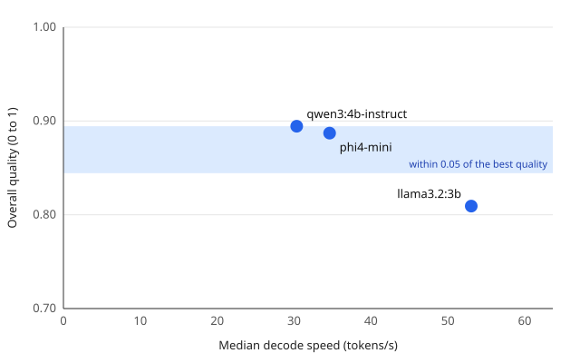
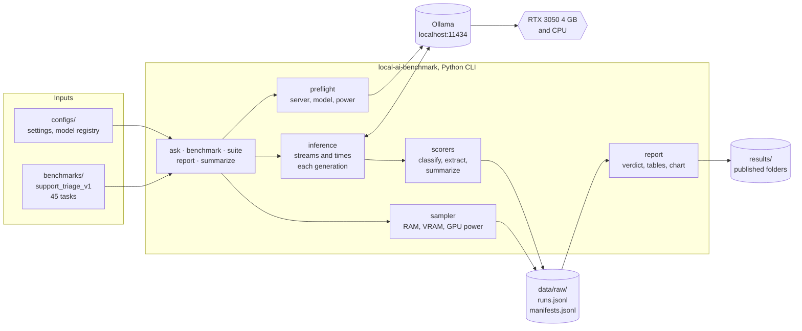

# Local AI Benchmark

[](https://github.com/saicharan-nidiganti/local-ai-benchmark/actions/workflows/ci.yml)
[](https://github.com/saicharan-nidiganti/local-ai-benchmark/releases)


[](LICENSE)

**Which small language model should you run on a laptop with a 4 GB GPU?** This project
answers by measurement. Three models served by [Ollama](https://ollama.com) run entirely
offline on the same machine, task suite and settings; every run is logged as raw JSONL with
its environment, and the report names the most accurate model, the fastest and the best
tradeoff.

<p align="center">
  <a href="results/2026-11-13-three-model-comparison/">
    
  </a>
</p>

| Model | Quality (0 to 1) | Decode speed | Median task latency | GPU energy per task | On GPU |
| --- | --- | --- | --- | --- | --- |
| qwen3:4b-instruct | **0.89** | 30.3 tokens/s | 1.43 s | 56 J | 66% |
| phi4-mini | **0.89** | 34.6 tokens/s | 1.24 s | 43 J | 64% |
| llama3.2:3b | 0.81 | **53.0 tokens/s** | **0.75 s** | **29 J** | 80% |

**Verdict: phi4-mini is the best tradeoff.** It matches qwen3:4b-instruct on quality with 14%
more speed and 23% less energy. llama3.2:3b is the fastest and as good at classification
and extraction, but its summaries miss facts.
[Full results](results/2026-11-13-three-model-comparison/).

> **Status: Phase 3 of 6 complete, release v0.2.0.** Measurement harness, task suite and
> three-model comparison are done. Next, Phase 4 measures the privacy, latency and cost
> constraints; Phase 5 ships the offline app. See [Project status](#project-status).

## Contents

- [Results](#results)
- [Why the numbers can be trusted](#why-the-numbers-can-be-trusted)
- [How it works](#how-it-works)
- [What it measures](#what-it-measures)
- [Quickstart](#quickstart)
- [Commands](#commands)
- [Reproducibility](#reproducibility)
- [Engineering](#engineering)
- [Project status](#project-status)
- [Documentation](#documentation)
- [Project layout](#project-layout)

## Results

Measured on the reference laptop (Ryzen 9 5900HX, RTX 3050 Laptop GPU 4 GB, 16 GB RAM,
Windows 11, plugged in), Ollama 0.40.16, every model Q4_K_M, on the 45 tasks of the
`support_triage_v1` suite: 15 fictional support tickets, each classified, extracted to JSON
and summarized.

- **qwen3:4b-instruct and phi4-mini are level on quality** (0.894 against 0.887, less than one
  label apart). qwen3:4b-instruct classifies slightly better; phi4-mini summarizes better.
- **phi4-mini is the best tradeoff**: the same quality, 14% faster decoding, 13% lower median
  latency and 23% less GPU energy per task.
- **llama3.2:3b is 1.75 times faster** than qwen3:4b-instruct at half the energy, and more of it
  fits on the GPU. It scores as well on classification and extraction; summaries drag it down
  (0.71).
- **Every model over-escalates priority.** Categories are right for 12 to 14 of 15 tickets,
  priorities for only 8 to 10, and 17 of the 18 wrong priorities are one level too high.
- **Structured output removes JSON failures**: all 90 JSON replies parse and match the schema.
- **No model fits in 4 GB of VRAM**: Ollama keeps 64 to 80% on the GPU and runs the rest on the
  CPU.

| Experiment | Finding |
| --- | --- |
| [Three-model comparison](results/2026-11-13-three-model-comparison/) | Findings, chart, quality per task and ticket category, speed, resources, run identities, limits, how to reproduce |
| [qwen3:4b baseline](results/2026-11-13-qwen3-4b-baseline/) | 30.8 tokens/s, 47 ms to the first token warm, 600 tokens/s prefill, 320 J per 256-token answer |

## Why the numbers can be trusted

Comparing local models is easy to get wrong. The first run includes loading the model,
sampling settings change how long the output is, a laptop on battery throttles its GPU, and a
single run hides variance. The harness controls for each:

- **Warm-up runs are excluded.** They execute before measurement and are never written to the
  dataset.
- **Settings are fixed and recorded.** Temperature 0, a fixed seed, context length and output
  limit are held constant and stored with every run.
- **The environment is recorded.** Each run ID has a manifest: hardware, power state, Ollama
  version, model digest and quantization, harness commit and whether the tree was clean.
- **Preflight checks run first.** A missing server or model stops the run before any request;
  running on battery warns, or stops with `--require-ac`.
- **Raw data is kept.** Every observation is appended to JSONL; nothing is overwritten or
  pre-aggregated, and every summary can be rebuilt from the log.
- **Summaries are robust.** Medians, which one slow run cannot skew, with p90 and the
  interquartile range beside them.
- **Failures are counted, not hidden.** A failed request is recorded with its error, raises the
  error rate and scores 0.

## How it works



Inference is local: the harness sends requests only to Ollama on localhost, and Phase 4 verifies
that no traffic leaves the machine ([#27](https://github.com/saicharan-nidiganti/local-ai-benchmark/issues/27)).
Context, components, the runtime sequence, the run-record schema and the deployment are in
[docs/architecture.md](docs/architecture.md).

## What it measures

**Speed and resources**, for every run:

| Metric | How it is measured |
| --- | --- |
| Time to first token (TTFT) | Wall-clock time from the request to the first streamed token, measured by the client |
| Total latency | Wall-clock time from the request until generation completes |
| Decode speed | Output tokens divided by the runtime-reported generation time |
| Prefill speed | Prompt tokens divided by the runtime-reported prompt-evaluation time |
| GPU share | How much of the loaded model sits in GPU memory, reported by Ollama after each run |
| Resource use | Peak RAM, runtime memory and GPU memory, mean GPU power and GPU energy, sampled every 0.5 s |
| Error rate | Failed runs divided by all runs |

**Quality**, for every task of the suite, from 0 to 1:

| Task | Score |
| --- | --- |
| Classify | Half for the right category, half for the right priority |
| Extract | A quarter for each field: order number, customer name, product and issue |
| Summarize | The share of required facts present; halved above 40 words |
| JSON | Strict, valid and schema-valid rates for the JSON tasks |

Definitions and the reasoning behind them: [docs/methodology.md](docs/methodology.md).

## Quickstart

Requires Python 3.11+, [uv](https://docs.astral.sh/uv/) and [Ollama](https://ollama.com).

```bash
ollama pull qwen3:4b-instruct && ollama pull phi4-mini && ollama pull llama3.2:3b

git clone https://github.com/saicharan-nidiganti/local-ai-benchmark.git && cd local-ai-benchmark
uv sync                       # creates .venv from uv.lock, with the dev tools
```

Ask one question and print its timings:

```bash
uv run local-ai-benchmark ask --model phi4-mini --prompt "Explain TCP vs UDP in 5 bullet points."
```

Reproduce the comparison: score each model on the 45 tasks, then write the report.

```bash
for model in qwen3-4b-instruct phi4-mini llama3.2-3b; do
  uv run local-ai-benchmark suite --model "$model" --require-ac
done
uv run local-ai-benchmark report --out-dir results/my-comparison --title "My comparison"
```

The report folder holds a README with the verdict and every table, the chart as SVG, and
the summaries and manifests as JSON. `python -m local_ai_benchmark` works in place of
`local-ai-benchmark`.

## Commands

| Command | What it does |
| --- | --- |
| `ask` | One prompt, one measured run, its metrics printed |
| `benchmark` | One prompt, warm-up runs, then repeated measured runs and their summary |
| `suite` | Every task of a suite (or one kind with `--tasks`), each reply scored |
| `report` | The latest suite run of each comparison model, or the `--run-id`s given, as a results folder |
| `summarize` | Rebuilds the summary of any run ID from the log; `--list` lists them |

`--model` takes an Ollama tag or an id from [configs/models.yaml](configs/models.yaml).
Settings come from [configs/benchmark.yaml](configs/benchmark.yaml); flags override them,
and every run records the values it used. Measuring commands also take `--require-ac`,
`--no-sampling` and `--output` (the run log; default `data/raw/runs.jsonl`). Exit codes: 0 done,
2 a configuration, suite, run-log or report error, 3 a preflight failure (server down, model not
pulled, or on battery with `--require-ac`). `--help` on any command lists every flag.

## Reproducibility

A measurement is only comparable with another taken under the same conditions. Keep these
fixed, and record them with the results (the manifest does most of it):

- hardware, and whether the machine is plugged in and otherwise idle
- model name, digest and quantization
- Ollama version
- prompts, sampling parameters, context length and maximum output tokens
- warm-up procedure and number of repetitions

The reference machine and its versions are in [docs/environment.md](docs/environment.md).

## Engineering

```bash
make check                    # lint, strict type check, tests with coverage
```

Without make (for example in Windows PowerShell), run the commands listed in
[CONTRIBUTING.md](CONTRIBUTING.md#everyday-commands).

- **Offline tests.** 153 tests replace the Ollama client with a simulated token stream, so they
  need no model, server or GPU. Coverage is 97% against a floor of 90%.
- **Strict checks.** Ruff for lint and format, mypy `--strict`, pre-commit hooks.
- **CI on every pull request**, all seven required to merge: lint and types, tests on Python 3.11
  to 3.14 and on Windows, and a package check that builds the wheel, installs it and runs it.
- **Protected main.** Pull requests only, linear history, one squash commit per change.
- **Tracked work.** Every change starts as an issue with acceptance criteria under a phase
  milestone; every consequential choice is an [architecture decision record](docs/decisions/).

## Project status

Each phase is a milestone; each task is an issue with acceptance criteria.

| Phase | Goal | Status | Release |
| --- | --- | --- | --- |
| 0. Foundation | Clean repository, tooling, documentation, working local runtime | Done | |
| 1. Measurement harness | Reproducible timing, manifests and resource sampling | Done | [v0.1.0](https://github.com/saicharan-nidiganti/local-ai-benchmark/releases/tag/v0.1.0) |
| 2. Task suite | Quality scoring for one privacy-sensitive use case | Done; optional [#22](https://github.com/saicharan-nidiganti/local-ai-benchmark/issues/22) open | |
| 3. Model comparison | Three models, same hardware and settings, quality against speed | Done; optional [#26](https://github.com/saicharan-nidiganti/local-ai-benchmark/issues/26) open | v0.2.0 |
| 4. Privacy, latency and cost | Constraints measured, not asserted | [Next](https://github.com/saicharan-nidiganti/local-ai-benchmark/milestone/5) | |
| 5. Offline app | A usable app on the recommended model | [Planned](https://github.com/saicharan-nidiganti/local-ai-benchmark/milestone/6) | v1.0.0 |

Gates and requirements per phase: [docs/roadmap.md](docs/roadmap.md) and
[docs/requirements.md](docs/requirements.md). Every milestone:
[milestones](https://github.com/saicharan-nidiganti/local-ai-benchmark/milestones?state=all).

## Documentation

| Document | Contents |
| --- | --- |
| [Requirements](docs/requirements.md) | What the project must do, with IDs, verification and status |
| [Architecture](docs/architecture.md) | Context, components, runtime flow, data model, deployment |
| [Methodology](docs/methodology.md) | Metric and score definitions, and how each is measured |
| [Environment](docs/environment.md) | Reference hardware, software versions, model digests |
| [Roadmap](docs/roadmap.md) | Phases, gates and milestones |
| [Decisions](docs/decisions/) | Architecture decision records |
| [Results](results/) | Every published experiment |
| [Contributing](CONTRIBUTING.md) | Setup, commands, workflow, definition of done |
| [Security](SECURITY.md) | Privacy model and vulnerability reporting |
| [Changelog](CHANGELOG.md) | Changes per release |

## Project layout

```text
.github/                  CI workflow, issue and pull request templates, CODEOWNERS, Dependabot
benchmarks/               versioned task suites: support_triage_v1, 15 fictional tickets
configs/                  benchmark settings and the model registry
data/raw/                 run log and manifests (git-ignored)
data/processed/           derived data (git-ignored)
docs/                     requirements, architecture, methodology, environment, roadmap
docs/decisions/           architecture decision records
results/                  published results, one folder per experiment
src/local_ai_benchmark/
  cli.py                  commands and argument parsing
  inference.py            streams one generation from Ollama and times it
  preflight.py            server and model checks before any request
  runtime.py              server version, model details, GPU placement
  config.py               settings and the model registry
  suite.py, scorers.py    the task suite, its prompts and scoring
  sampler.py              RAM, VRAM and GPU power during each run
  manifest.py             the environment of each run ID
  metrics.py              run log, run IDs, medians and spreads
  report.py               comparison report: verdict, tables and chart
  paths.py                where the project and the run log live
tests/                    offline test suite
```

## License

[MIT](LICENSE)
