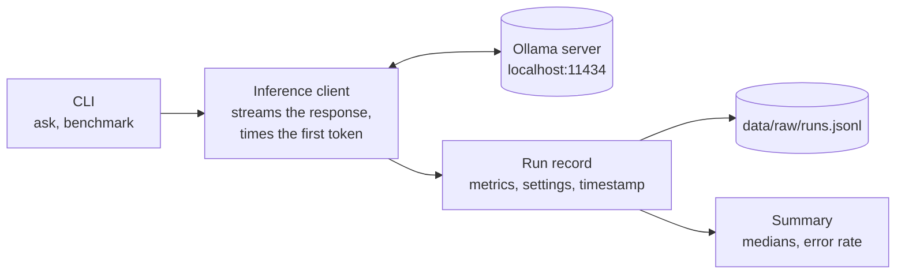

# Local AI Benchmark

[](https://github.com/saicharan-nidiganti/local-ai-benchmark/actions/workflows/ci.yml)

[](LICENSE)

Small language models running **entirely offline** on a laptop, measured properly. The
harness runs models served by [Ollama](https://ollama.com) on your own machine and records
time to first token, end-to-end latency and generation throughput for every run as raw JSONL,
so results can be audited and compared under fixed conditions. It is growing into an offline
app backed by a published comparison of three models on a 4 GB laptop GPU, with the privacy,
latency and cost tradeoffs measured.

> **Status: Phase 1 of 6 complete, release v0.1.0.** The measurement harness records
> timings, resource use and the environment of every run, and the first baseline is
> published below. Next: quality scoring on a task suite (Phase 2), then the three-model
> comparison and the offline app. See [Project status](#project-status).

## Why

Comparing local models is easy to get wrong. The first run includes loading the model,
sampling settings change how long the output is, and a single run hides variance. The harness
controls for each of these:

- **Warm-up runs are excluded.** They execute before measurement and are never written to
  the dataset.
- **Settings are fixed and recorded.** Model, prompt, temperature and output-token limit are
  held constant within a benchmark and stored with every run.
- **Raw data is kept.** Every observation is appended to JSONL; nothing is overwritten or
  pre-aggregated.
- **Summaries are robust.** Results are reported as medians, which a single slow run cannot
  skew, with p90 and the interquartile range beside them.
- **Failures are counted, not hidden.** A failed run is recorded with its error and
  contributes to the error rate.

## What it measures

| Metric | How it is measured |
| --- | --- |
| Time to first token (TTFT) | Wall-clock time from the request to the first streamed token, measured by the client |
| Total latency | Wall-clock time from the request until generation completes |
| Output tokens | Token count reported by the Ollama runtime |
| Throughput | Output tokens divided by the runtime-reported generation time, in tokens per second |
| Prefill speed | Prompt tokens divided by the runtime-reported prompt-evaluation time |
| Load and prompt time | Model load and prompt-processing durations reported by Ollama |
| Error rate | Failed runs divided by all runs in the benchmark |
| Resource use | Peak RAM, runtime memory and GPU memory, mean GPU power and GPU energy, sampled every 0.5 s |
| GPU share | How much of the loaded model sits in GPU memory, reported by Ollama after each run |

Definitions and the reasoning behind them: [docs/methodology.md](docs/methodology.md).

## Architecture



Context, components, the runtime sequence, the run-record schema and the deployment are in
[docs/architecture.md](docs/architecture.md).

## Quickstart

Requires Python 3.11+, [uv](https://docs.astral.sh/uv/), and a running Ollama with a model
pulled.

```bash
ollama pull qwen3:4b

git clone https://github.com/saicharan-nidiganti/local-ai-benchmark.git && cd local-ai-benchmark
uv sync                            # creates .venv from uv.lock, with the dev tools
```

Run a single prompt and print its metrics:

```bash
uv run local-ai-benchmark ask --model qwen3:4b --prompt "Explain TCP vs UDP in 5 bullet points."
```

Benchmark one prompt with one warm-up run and five measured runs:

```bash
uv run local-ai-benchmark benchmark --model qwen3:4b \
  --prompt "Explain TCP vs UDP in 5 bullet points." \
  --repeats 5 --warmup-runs 1 --temperature 0 --max-output-tokens 256
```

Settings come from [configs/benchmark.yaml](configs/benchmark.yaml) (temperature, output limit,
seed, context length, repeats); flags override them, and every run records the values it used.
`--model` takes an Ollama tag or an id from [configs/models.yaml](configs/models.yaml).

Each measured run is appended to `data/raw/runs.jsonl`, and the command prints a summary with
the run count, error rate, and median latency, TTFT and throughput.
`python -m local_ai_benchmark` works in place of `local-ai-benchmark`.

Score a model on the whole task suite (45 support-ticket tasks: classify, extract, summarize):

```bash
uv run local-ai-benchmark suite --model qwen3-4b-instruct   # --tasks classify for one kind
uv run local-ai-benchmark suite --model phi4-mini --json-mode prompt # JSON from the prompt alone
```

Every benchmark and suite run gets a run ID. Rebuild its summary from the log at any time:

```bash
uv run local-ai-benchmark summarize --list              # benchmark and suite runs in the log
uv run local-ai-benchmark summarize --run-id <run ID>   # default: the latest
```

## Results

Baseline on the reference laptop (Ryzen 9 5900HX, RTX 3050 4 GB), qwen3:4b Q4_K_M, 1 warm-up
and 5 measured runs, 256 output tokens:

| Metric | Median |
| --- | --- |
| Decode speed | 30.8 tokens/s (IQR 0.2) |
| Time to first token, warm | 47 ms |
| Prefill speed | 600 tokens/s |
| Model share in GPU memory | 66% at a 4096-token context |
| GPU energy per 256-token answer | 320 J |

Only two thirds of a 4B model fits in 4 GB of VRAM; the rest runs from system memory. Setup,
full statistics, the environment manifest and every run:
[results/2026-11-13-qwen3-4b-baseline](results/2026-11-13-qwen3-4b-baseline/).

## Reproducibility

A measurement is only comparable with another taken under the same conditions. Keep these
fixed, and record them with the results:

- hardware, and whether the machine is plugged in and otherwise idle
- model name, digest and quantization
- Ollama version
- prompt, sampling parameters and maximum output tokens
- warm-up procedure and number of repetitions

The reference machine and its versions are in [docs/environment.md](docs/environment.md).

## Testing

```bash
make check                         # lint, strict type check, tests with coverage
```

Without make (for example in Windows PowerShell), run the commands listed in
[CONTRIBUTING.md](CONTRIBUTING.md#everyday-commands).

The suite is offline: it replaces the Ollama client with a simulated token stream, so it
needs no model or server. It covers metric calculation, throughput edge cases, connection
failures and streams that fail partway, warm-up exclusion, thinking being disabled, and the
settings stored with each run. CI runs Ruff, mypy `--strict` and the tests (coverage floor
90%) on Python 3.11 to 3.14 and on Windows, and checks that the built wheel installs and runs.

## Project status

Each phase is a milestone; each task is an issue with acceptance criteria.

| Phase | Goal | Release | Tracking |
| --- | --- | --- | --- |
| 0. Foundation | Clean repository, tooling, documentation, working local runtime | | [milestone](https://github.com/saicharan-nidiganti/local-ai-benchmark/milestone/1) |
| 1. Measurement harness | Reproducible timing, manifests and resource sampling | v0.1.0 | [milestone](https://github.com/saicharan-nidiganti/local-ai-benchmark/milestone/2) |
| 2. Task suite | Quality scoring for one privacy-sensitive use case | | [milestone](https://github.com/saicharan-nidiganti/local-ai-benchmark/milestone/3) |
| 3. Model comparison | Three models, same hardware and settings, quality against speed | v0.2.0 | [milestone](https://github.com/saicharan-nidiganti/local-ai-benchmark/milestone/4) |
| 4. Privacy, latency and cost | Constraints measured, not asserted | | [milestone](https://github.com/saicharan-nidiganti/local-ai-benchmark/milestone/5) |
| 5. Offline app | A usable app on the recommended model | v1.0.0 | [milestone](https://github.com/saicharan-nidiganti/local-ai-benchmark/milestone/6) |

Gates and requirements per phase: [docs/roadmap.md](docs/roadmap.md) and
[docs/requirements.md](docs/requirements.md).

## Documentation

| Document | Contents |
| --- | --- |
| [Requirements](docs/requirements.md) | What the project must do, with IDs, verification and status |
| [Architecture](docs/architecture.md) | Context, components, runtime flow, data model, deployment |
| [Methodology](docs/methodology.md) | Metric definitions and how each is measured |
| [Environment](docs/environment.md) | Reference hardware, software versions, model digests |
| [Roadmap](docs/roadmap.md) | Phases, gates and milestones |
| [Decisions](docs/decisions/) | Architecture decision records |
| [Contributing](CONTRIBUTING.md) | Setup, commands, workflow, definition of done |
| [Security](SECURITY.md) | Privacy model and vulnerability reporting |
| [Changelog](CHANGELOG.md) | Changes per release |

## Project layout

```text
.github/                  CI workflow, issue and pull request templates
benchmarks/               versioned task suites: support_triage_v1, 15 fictional tickets
configs/                  benchmark settings and model definitions
data/raw/                 run log (git-ignored)
docs/                     requirements, architecture, methodology, environment, roadmap
docs/decisions/           architecture decision records
reports/                  generated reports and figures
results/                  curated, published results, one folder per experiment
src/local_ai_benchmark/   cli.py (commands), inference.py (Ollama client and timing),
                          metrics.py (run log and summaries)
tests/                    offline test suite
```

## License

[MIT](LICENSE)
