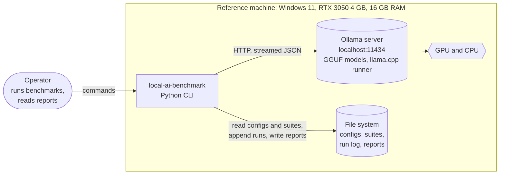
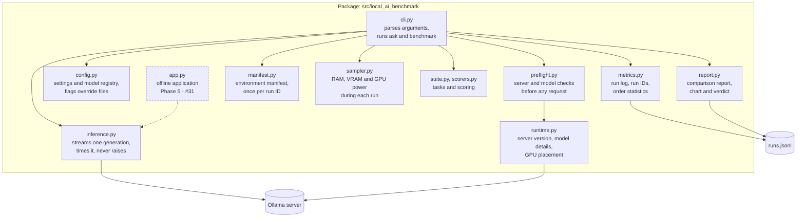
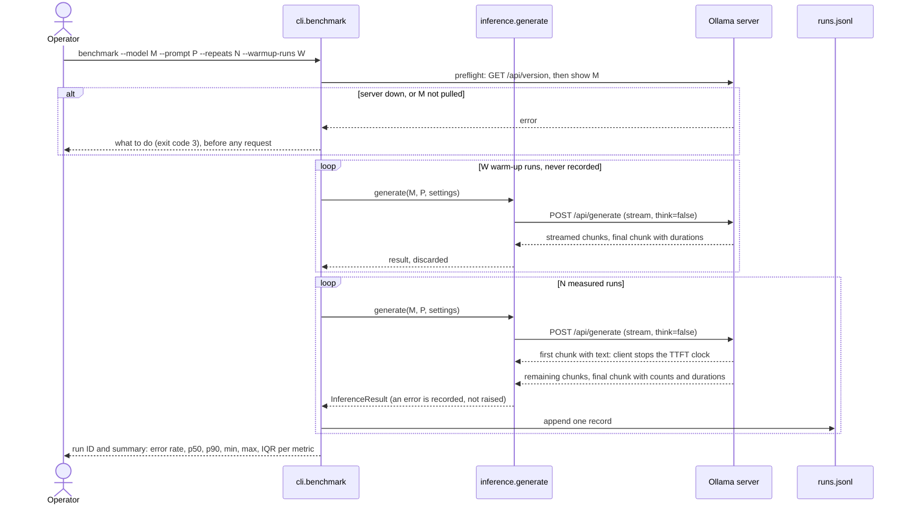

# Architecture

Last updated: 2026-11-13 · Applies to: `main` after Phase 0

This document describes how local-ai-benchmark is built today and how it grows through the
[roadmap](roadmap.md). Parts that do not exist yet are marked **planned**, with the phase and
issue that add them; their module names are provisional. Requirement IDs (FR-*, NFR-*) refer
to [requirements.md](requirements.md); decisions are recorded in [decisions/](decisions/).

## 1. Context

One person runs the harness on one machine. The harness talks to one local service, the
Ollama server, and to the file system. Nothing leaves the machine (FR-9).



| Element | Responsibility | Owned by |
| --- | --- | --- |
| Operator | Chooses models and settings, runs benchmarks, reads results | Person |
| local-ai-benchmark | Sends requests, measures them, records every run, summarizes and reports | This repository |
| Ollama server | Loads quantized models, splits layers between GPU and CPU, generates tokens, reports durations | [Ollama](https://ollama.com), [ADR-0002](decisions/0002-ollama-as-the-local-runtime.md) |
| File system | Holds inputs (configs, suites) and outputs (run log, reports) | This repository's folders |

## 2. Containers

| Container | Technology | Lifetime | Notes |
| --- | --- | --- | --- |
| CLI process | Python 3.11+, `local-ai-benchmark` console script | One per command | Stateless between commands; all state is in files |
| Ollama server | Ollama 0.40 (reference), HTTP on `localhost:11434` | Long-running service | Keeps a model loaded for `keep_alive` (5 minutes by default here) |
| Run log | JSON Lines, `data/raw/runs.jsonl` | Append-only, git-ignored | [ADR-0003](decisions/0003-append-only-jsonl-run-log.md) |
| Manifests | JSON Lines, `data/raw/manifests.jsonl` | One line per run ID, git-ignored | [ADR-0007](decisions/0007-run-identity-and-manifests.md) |
| Configuration | YAML, `configs/benchmark.yaml` and `configs/models.yaml` | Versioned in git | Read on every command; flags override ([ADR-0006](decisions/0006-configuration-and-pinned-settings.md)) |
| Task suites | JSON Lines, `benchmarks/support_triage_v1.jsonl` | Versioned in git | 15 fictional tickets, 45 tasks ([benchmarks/README.md](../benchmarks/README.md), [ADR-0008](decisions/0008-use-case-support-ticket-triage.md)) |
| Reports | A results folder: `README.md`, `quality_vs_speed.svg`, `summaries.json`, `manifests.json` | Curated output committed under `results/` | Written by `report` |

## 3. Components



Solid boxes and arrows exist today; dashed ones are planned.

| Module | Responsibility | Public interface | Depends on |
| --- | --- | --- | --- |
| `cli.py` | Parse arguments; resolve settings; run the preflight; run `ask` (one request) and `benchmark` (warm-ups, then measured runs); print results; map failures to exit codes | `main(argv)`, `build_parser()`, `ask(args)`, `benchmark(args)` | `config`, `preflight`, `inference`, `metrics`, `paths` |
| `inference.py` | Stream one generation from Ollama, time the first token on the client, read the runtime's durations, and turn any failure into a recorded error | `generate(model, prompt, settings, output_format) -> InferenceResult`; `output_format` is a JSON schema the runtime constrains the reply to | `ollama` client, `config` |
| `config.py` | Load `benchmark.yaml` and `models.yaml`, validate every key and type, apply command-line overrides, resolve a model id to its Ollama tag | `load_settings(path)`, `with_overrides(settings, **flags)`, `load_models(path)`, `resolve_model(name, models)`, `GenerationSettings.options()` | PyYAML |
| `metrics.py` | Append records to the run log and read them back; issue run IDs; group records by run; summarize a run with medians and order statistics | `append_jsonl`, `read_jsonl`, `new_run_id`, `benchmark_runs`, `select_run`, `summarize`, `run_summary`, `spread` | standard library |
| `runtime.py` | Ask the Ollama server for its version, a model's details and digest, and where a loaded model sits (GPU or CPU); read `OLLAMA_HOST` as the Ollama client does | `host()`, `server_version()`, `model_details(name)`, `loaded_model(name)` | `ollama` client, `httpx` |
| `preflight.py` | Before any request, confirm the server answers, the model is pulled, and the model can think if `--think` was given; otherwise fail with what to do | `check(model, think) -> Preflight`, `PreflightError` | `runtime` |
| `manifest.py` | Describe the environment of one run ID: harness version and git commit, Python, OS, CPU, RAM, NVIDIA GPUs, AC power, Ollama version and host, model digest and capabilities; each probe degrades to null | `collect(run_id, server_version, model)`, `manifest_log(run_log)` | `runtime`, `psutil`, `git` and `nvidia-smi` when present |
| `sampler.py` | Sample, in a background thread, system RAM, the memory of the Ollama server and its model runner, and GPU memory and power (`nvidia-smi`) while one request runs; summarize peaks, mean power and GPU energy | `ResourceSampler` (context manager), `summarize_samples(samples, duration_s)`, `ResourceSummary.record()` | `psutil`, `nvidia-smi` when present |
| `suite.py` | Load and validate a suite file (pydantic: label sets, required keys, duplicate ids); expand each ticket into classify, extract and summarize tasks with the versioned prompts | `load_suite(path) -> Suite`, `Suite.tasks()`, `Task.prompt`, `SuiteError` | pydantic |
| `scorers.py` | Score a reply from 0 to 1 for its task kind: label match, field accuracy, summary facts and length; judge JSON as strict, recovered or invalid, and schema-valid against pydantic models | `score(task, reply) -> Score`, `parse_json_object`, `normalize` | `suite`, pydantic |
| `report.py` | Compare suite runs of several models: quality overall, per task kind and per ticket category; speed, GPU share, power and energy; the run identities; a verdict (most accurate, fastest, best tradeoff); and a quality-against-speed chart as SVG | `model_result(run_id, records, suite, manifest)`, `verdict(results)`, `write_report(results, out_dir, title)` | `metrics`, `suite` |
| `targets.py` | The latency targets for interactive use, each with its limit, unit and cited reason | `TARGETS`, `Target.met(value)` | none |
| `paths.py` | Locate the project folder (`LOCAL_AI_BENCHMARK_HOME`, else the source checkout, else the working folder) and the default run log in it | `project_root()`, `default_run_log()` | standard library |

Dependency rules: no module imports `cli`; only `inference` (generation) and `runtime`
(everything else) talk to Ollama; only `metrics` writes the run log. Planned modules keep the same direction: the CLI
composes, the lower modules do one job each.

## 4. Runtime view

### 4.1 A benchmark command



`suite` runs every task of a suite in the same way (warm-up on the first task, then each task
once, or `--repeats` times), scores each reply, and records it with `run_type: "suite"`. Its
summary adds quality per task kind and the JSON rates beside the speed summary.

`ask` is the same request once, recorded with `run_type: "single"` and its own run ID,
without warm-up or summary. `summarize --run-id ID` reads the log and prints exactly the
summary the benchmark printed; without an ID it takes the latest benchmark, and `--list`
shows them all.

### 4.2 What each timing covers

```text
client sends request                          first visible token              last token
      |-- model load --|-- prompt evaluation --|-- decode ---------------------------|
      |<----------------- ttft_ms (client clock) ------>|
      |<------------------------------ total_latency_ms (client clock) ------------->|
       load_duration_ms   prompt_eval_duration_ms       generation_ms (Ollama's eval_duration)
```

- **Client-side** (`time.perf_counter`): `ttft_ms` and `total_latency_ms`. They include HTTP
  and streaming overhead, which is what a user of the model experiences.
- **Runtime-side** (Ollama's nanosecond durations): `load_duration_ms`,
  `prompt_eval_duration_ms`, `generation_ms`, and the token counts.
- **Throughput** is `output_tokens / generation_ms`: decode speed. **Prefill speed** is
  `prompt_tokens / prompt_eval_duration_ms`: how fast the prompt is read, which dominates
  for long prompts.
- A cold start puts the model load inside TTFT; warm-up runs exist to keep it out of the
  measured runs ([ADR-0004](decisions/0004-measurement-protocol.md)).

## 5. Data model: the run record

One JSON object per line in `data/raw/runs.jsonl`. Version 1, as written today:

| Field | Type | Unit | Source | Notes |
| --- | --- | --- | --- | --- |
| `timestamp` | string | ISO 8601, UTC | CLI | When the record was written |
| `run_id` | string | | CLI | Shared by every record of one invocation, for example `20261113T061512Z-3fa9c2` |
| `run_type` | string | | CLI | `single` (ask) or `benchmark` |
| `run_index` | integer | | CLI | 1 to N; benchmark only |
| `model_id` | string | | registry | The id from `configs/models.yaml`, or the tag itself when the model is not registered |
| `temperature` | number | | settings | |
| `max_output_tokens` | integer | tokens | settings | Sent as Ollama's `num_predict` |
| `seed` | integer | | settings | Sampling seed, pinned |
| `num_ctx` | integer | tokens | settings | Context length, pinned; it also sets the model's memory footprint |
| `keep_alive` | string | duration | settings | How long Ollama keeps the model loaded |
| `think` | boolean | | settings | Whether a thinking model may reason before answering; off by default |
| `model` | string | | request | Ollama model tag, for example `qwen3:4b` |
| `prompt` | string | | request | Full prompt text |
| `response` | string | | stream | Concatenated visible reply |
| `ttft_ms` | number or null | ms | client | Null when no text arrived |
| `total_latency_ms` | number | ms | client | Always present, also on failure |
| `output_tokens` | integer or null | tokens | Ollama `eval_count` | |
| `generation_ms` | number or null | ms | Ollama `eval_duration` | |
| `tokens_per_sec` | number or null | tokens/s | derived | Null when the runtime reports no generation time |
| `load_duration_ms` | number or null | ms | Ollama `load_duration` | |
| `prompt_tokens` | integer or null | tokens | Ollama `prompt_eval_count` | |
| `prompt_eval_duration_ms` | number or null | ms | Ollama `prompt_eval_duration` | |
| `prefill_tokens_per_sec` | number or null | tokens/s | derived | Null when the runtime reports no prompt time |
| `error` | string or null | | inference | `ExceptionType: message`; null on success |
| `resource_samples` | integer | | sampler | Samples taken during the run; 0 with `--no-sampling` |
| `peak_system_ram_mb` | number or null | MiB | sampler | System memory in use, peak |
| `peak_runtime_rss_mb` | number or null | MiB | sampler | Ollama server plus model runner (`llama-server`), peak; holds the part of the model not on the GPU |
| `peak_gpu_memory_mb` | number or null | MiB | sampler | GPU memory in use, peak (`nvidia-smi`) |
| `mean_gpu_power_w` | number or null | W | sampler | GPU board power, mean over the samples |
| `gpu_energy_j` | number or null | J | derived | Mean GPU power times `total_latency_ms` |
| `start` | `cold` or `warm` | | benchmark | Whether the model was unloaded before the run (`benchmark --cold`); benchmark records only |
| `remote_connections` | integer or null | count | sampler | Distinct remote ends of connections from Ollama, its runner or the harness to another machine during the run; null when the connection table cannot be read |
| `remote_endpoints` | list or null | `address:port` | sampler | Those remote ends |
| `gpu_offload_pct` | number or null | % | Ollama `/api/ps` | Share of the loaded model's memory on the GPU, read after the run |
| `loaded_context_length` | integer or null | tokens | Ollama `/api/ps` | Context the model was loaded with |

The environment of a run is not repeated on each record: it is the line with the same
`run_id` in `manifests.jsonl` ([ADR-0007](decisions/0007-run-identity-and-manifests.md)), with
the sections `harness`, `python`, `os`, `cpu`, `memory_total_gb`, `gpus`, `power`, `runtime`
and `model`.

Suite records (`run_type: "suite"`) add:

| Field | Type | Notes |
| --- | --- | --- |
| `suite` | string | Suite name and version, for example `support_triage_v1` |
| `task_id` | string | `<ticket>:<task>`, for example `T04:extract` |
| `ticket_id` | string | The ticket the task comes from |
| `task` | string | `classify`, `extract` or `summarize` |
| `json_mode` | string or null | `schema` (the runtime enforces the task's JSON schema) or `prompt`; null for summaries ([ADR-0009](decisions/0009-structured-output-for-json-tasks.md)) |
| `score` | number | 0 to 1; 0 for a failed run |
| `json_strict` | boolean or null | The whole reply is one JSON object; null for summaries |
| `json_valid` | boolean or null | A JSON object could be recovered from the reply |
| `schema_valid` | boolean or null | The object has the required keys and allowed labels |
| `score_details` | object | Per-check results: labels, fields, facts found, word count |

## 6. Deployment view

| Layer | Reference value | Recorded in |
| --- | --- | --- |
| Hardware | ASUS ROG Strix G513QC: AMD Ryzen 9 5900HX, NVIDIA RTX 3050 Laptop GPU 4 GB, 15.4 GB RAM | [environment.md](environment.md) |
| Operating system | Windows 11 | [environment.md](environment.md) |
| Runtime | Ollama 0.40.16, llama.cpp runner, `localhost:11434` | [environment.md](environment.md) |
| Harness | Python 3.11 to 3.14, installed from `uv.lock` | `pyproject.toml`, `uv.lock` |
| CI | GitHub Actions: Ubuntu (Python 3.11 to 3.14) and Windows (3.14); no model, no GPU | `.github/workflows/ci.yml` |

CI never runs a model: the tests replace the Ollama client with simulated streams
(NFR-2). Live measurements happen only on the reference machine.

## 7. Repository layout

```text
.github/                  CI workflow, issue and pull request templates, CODEOWNERS, Dependabot
benchmarks/               versioned task suites and their format
configs/                  benchmark settings and the model registry
data/raw/                 run log, git-ignored
data/processed/           derived data, git-ignored
docs/                     requirements, architecture, roadmap, methodology, environment
docs/decisions/           architecture decision records
results/                  published results, one folder per experiment, written by report or by hand
src/local_ai_benchmark/   the package: cli, inference, preflight, runtime, config, suite,
                          scorers, sampler, manifest, metrics, report, paths
tests/                    offline test suite
CHANGELOG.md              changes per release, Keep a Changelog format
CONTRIBUTING.md           setup, workflow, definition of done
Makefile                  the commands CI runs
pyproject.toml, uv.lock   package metadata, tool settings, locked dependencies
```

## 8. Cross-cutting concerns

**Error handling.** `generate()` catches every exception and returns an `InferenceResult`
with `error` set, keeping a TTFT if text had already arrived. A benchmark therefore always
completes and reports its error rate (NFR-4). A reply with no visible text is a failure too
(`empty_response`), with the runtime's token counts kept for diagnosis. Problems that would
make every run fail are caught before the first one: the preflight checks that the server is
on this machine, that it answers, and that the model is pulled. Exit codes: 0 success, 2 configuration error, 3 runtime or model unavailable.

**Reproducibility.** Warm-up exclusion; every generation setting pinned and recorded; a
run ID on every record; one environment manifest per run ID; every observation kept
(FR-4, FR-5).

**Privacy.** The harness sends requests only to an Ollama server on this machine: the
preflight refuses any other host unless `--allow-remote` is given, and sends no telemetry.
The sampler records every connection from Ollama, its runner or the harness to another
machine during each run, and the manifest records the network interfaces that were up
([ADR-0011](decisions/0011-local-only-runtime-and-connection-audit.md)). The run log holds
full prompts and replies, so it stays git-ignored. See [SECURITY.md](../SECURITY.md).

**Testing.** Unit tests replace `ollama.generate` with generators that yield chunks, raise
errors or stop midway, and replace `cli.generate` with a stub; files go to `tmp_path`.
Coverage is measured with branches and must stay at 90% or more.

**Configuration precedence.** Built-in defaults, then `configs/benchmark.yaml`, then
command-line flags given explicitly; `--config` and `--models` point at other files. Unknown
keys and wrong types are rejected with the file and key named. The effective values are
recorded on every run ([ADR-0006](decisions/0006-configuration-and-pinned-settings.md)).

## 9. Quality attributes

| Attribute | How the design addresses it today | Planned |
| --- | --- | --- |
| Reproducibility | Pinned and recorded settings; warm-up exclusion; run IDs; environment manifests; raw log kept | |
| Measurement validity | Client TTFT plus runtime durations; prefill and decode speed; medians with p90 and IQR; thinking disabled; memory, GPU power, energy and GPU share per run | |
| Privacy | Local-only host enforced; connections to other machines audited on every run; no telemetry; raw log git-ignored | |
| Robustness | Failures recorded, never raised; an empty reply is a failure; a preflight fails fast when the server or model is missing | |
| Testability | Offline tests with simulated streams, a fake GPU probe and a fake sampler; 96% coverage | |
| Maintainability | src layout, strict typing, Ruff, locked dependencies, ADRs | Protected `main` (#8) |
| Portability | Windows and Linux in CI | |

## 10. Known limitations

- On the reference GPU, qwen3:4b at a 4096-token context keeps about a third of its memory
  on the CPU ([environment.md](environment.md#first-live-run)).

## 11. Decisions

| ADR | Decision |
| --- | --- |
| [0001](decisions/0001-record-architecture-decisions.md) | Record architecture decisions |
| [0002](decisions/0002-ollama-as-the-local-runtime.md) | Ollama as the local inference runtime |
| [0003](decisions/0003-append-only-jsonl-run-log.md) | An append-only JSON Lines run log |
| [0004](decisions/0004-measurement-protocol.md) | Measurement protocol |
| [0005](decisions/0005-packaging-and-toolchain.md) | Packaging and toolchain |
| [0006](decisions/0006-configuration-and-pinned-settings.md) | Configuration precedence and pinned generation settings |
| [0007](decisions/0007-run-identity-and-manifests.md) | Run identity and environment manifests |
| [0008](decisions/0008-use-case-support-ticket-triage.md) | Use case: support-ticket triage |
| [0009](decisions/0009-structured-output-for-json-tasks.md) | Structured output for the JSON tasks |
| [0010](decisions/0010-three-models-to-compare.md) | The three models to compare |
| [0011](decisions/0011-local-only-runtime-and-connection-audit.md) | A local-only runtime by default, and a connection audit on every run |
