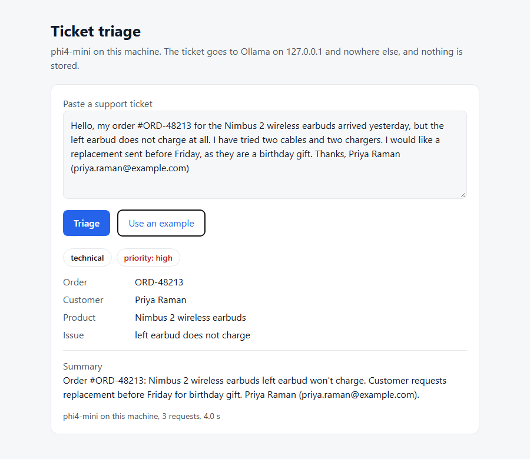

# The triage app, with networking off

The offline app ([ADR-0012](../../docs/decisions/0012-offline-triage-app.md)) on the recommended
model, phi4-mini, checked with Wi-Fi disabled and Ethernet disconnected: the `triage` command on
three fictional tickets, then the `serve` web page answering a ticket over its API and refusing
a request addressed to another host name.

## Findings

1. **The app works with networking off.** Every ticket was answered, by the command and by the
   web page, with github.com unreachable before the first ticket and after the last.
2. **A ticket takes about 3 s.** Three requests (classify, extract, summarize) took 2.7 to 3.6 s
   with the model loaded, and 8.7 s for the first ticket, which included loading the model.
   The first token of each request arrived in 55 to 202 ms.
3. **The guards hold.** A request with a foreign `Host` header was refused with 403.
4. **The answers show the limits the comparison measured.** Ticket 3, a delay, is rated high
   where the prompt's rubric says medium: the over-escalation every model showed. Ticket 2, money
   back for a duplicate charge, is filed as billing where the rubric's refund fits better.

| Ticket | Category | Priority | Order | Customer | Product | Issue | Time |
| --- | --- | --- | --- | --- | --- | --- | --- |
| [1](ticket-1.txt): earbud does not charge | technical | high | ORD-48213 | Priya Raman | Nimbus 2 wireless earbuds | left earbud does not charge | 3.6 s |
| [2](ticket-2.txt): charged twice | billing | high | INV-7731 | Tomas Weber | Pro plan | charged twice | 2.7 s |
| [3](ticket-3.txt): parcel stuck | shipping | high | ORD-55120 | Lena Ortiz | - | parcel stuck in transit for 9 days | 2.9 s |

Times are the `--json` runs, with the model loaded; the answers and summaries are in
`triage-ticket-*.json`, and the web page's answer to ticket 2 is in
[api-triage.json](api-triage.json).



The page as it looks with the example ticket. The screenshots were taken right after the check,
from the same build, with networking on: the browser could not be run from the scheduled task
that held the network down. The page loads nothing from elsewhere (its Content-Security-Policy
is `default-src 'none'`, and a test checks it names no external URL), so it renders the same
offline.

## Setup

| | |
| --- | --- |
| Machine | Reference laptop: Ryzen 9 5900HX, RTX 3050 Laptop GPU 4 GB, 16 GB RAM, Windows 11, plugged in ([environment](../../docs/environment.md)) |
| Network | Wi-Fi disabled with `netsh` by a scheduled task, Ethernet disconnected; github.com unreachable before the first ticket and after the last |
| Model | phi4-mini, Q4_K_M, digest `78fad5d182a7`, Ollama 0.40.16 on 127.0.0.1 |
| App | Commit `038f67e`, clean tree; the suite's prompts and schemas, temperature 0, seed 42 |
| When | 2026-11-13, 12:38 to 12:39 UTC |

## Reproduce

```bash
# with networking off
uv run local-ai-benchmark triage results/2026-11-13-offline-app/ticket-1.txt
uv run local-ai-benchmark triage results/2026-11-13-offline-app/ticket-2.txt --json
uv run local-ai-benchmark serve      # then open http://127.0.0.1:8765 and "Use an example"
```
