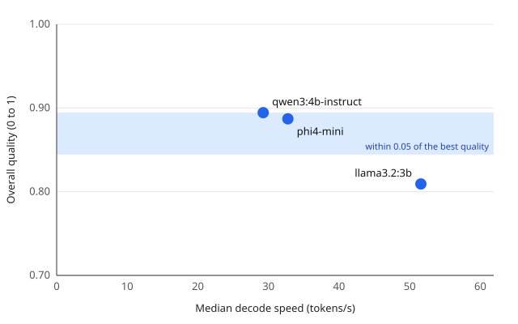

# Privacy, latency and cost, measured offline

Suite `support_triage_v1` (45 tasks), JSON mode `schema`, one run per task after a warm-up, same machine and settings for every model.

- **Most accurate:** qwen3:4b-instruct
- **Fastest:** llama3.2:3b
- **Best tradeoff:** phi4-mini (the fastest model within 0.05 of the best quality)



## Findings

1. **Nothing depends on the network, and nothing left the machine.** With Wi-Fi disabled and
   Ethernet disconnected (github.com unreachable before and after), all 135 suite tasks and 15
   cold starts completed. The connection audit found 0 connections from Ollama, its model
   runner or the harness to another machine. The only interfaces up were VMware's host-only
   adapters, which reach only this machine's virtual machines.
2. **Offline gives the same answers.** Every model returned the same reply, byte for byte, to
   all 45 tasks as in the online comparison earlier the same day, so the quality scores are
   identical: 0.89, 0.89 and 0.81. Decode speed was 3 to 6% lower than in the morning
   (29.3 against 30.3 tokens/s for qwen3:4b-instruct), the ordinary drift between sessions.
3. **Every model meets every latency target for interactive use.** The first token arrives in
   92 to 203 ms with the model loaded, five to ten times inside the 1 s limit; decoding runs at
   29 to 52 tokens/s against a target of 10; and with the model not loaded the first token
   takes a median 3.3 to 4.5 s, inside 10 s. The slowest cold start, each model's first load in
   the window, took 5.5 to 7.0 s.
4. **Local electricity is cheap; buying the hardware for this alone is not.** Per million
   output tokens, the GPU's electricity costs INR 1.93 to 3.57, against INR 18.90 to 31.18 for
   the same model hosted: 5 to 16 times less. Per 1,000 tasks the gap widens to 20 to 30 times
   (INR 0.07 to 0.11 against 1.83 to 3.35), because hosted APIs also charge for the 137 to 161
   prompt tokens of every task. Counting the laptop's whole price over 4 years of 8 hours a day
   turns it around: INR 61 to 109 per million tokens locally, 2 to 6 times the hosted price.
5. **The cost case for local is a machine already owned.** On hardware bought for other work,
   the extra cost of running these models is the electricity, and the prompts never leave the
   machine. For a workload that would need hardware bought for it, a hosted API is cheaper per
   token, as long as the data may leave the machine.

The verdict and the tables below are written by `local-ai-benchmark report`; the findings are
written by hand from them and from the run log.

## Quality

| Model | JSON mode | Overall | Classify | Extract | Summarize | Valid JSON | Schema-valid |
| --- | --- | --- | --- | --- | --- | --- | --- |
| qwen3:4b-instruct | schema | 0.89 | 0.77 | 0.98 | 0.93 | 100% | 100% |
| phi4-mini | schema | 0.89 | 0.73 | 0.95 | 0.98 | 100% | 100% |
| llama3.2:3b | schema | 0.81 | 0.73 | 0.98 | 0.71 | 100% | 100% |

Quality by ticket category (mean over each ticket's three tasks):

| Model | Billing | Refund | Shipping | Technical | Account |
| --- | --- | --- | --- | --- | --- |
| qwen3:4b-instruct | 0.80 | 0.89 | 0.91 | 0.94 | 0.94 |
| phi4-mini | 0.81 | 0.94 | 0.94 | 0.85 | 0.89 |
| llama3.2:3b | 0.72 | 0.89 | 0.83 | 0.78 | 0.82 |

## Speed and resources

| Model | Decode (tokens/s) | Prefill (tokens/s) | TTFT p50 (ms) | Latency p50 / p90 (ms) | On GPU | Peak GPU memory (MiB) | Mean GPU power (W) | GPU energy per task (J) |
| --- | --- | --- | --- | --- | --- | --- | --- | --- |
| qwen3:4b-instruct | 29.3 | 822 | 190 | 1,446 / 1,903 | 66% | 2,339 | 39.5 | 56 |
| phi4-mini | 32.7 | 680 | 203 | 1,279 / 1,590 | 64% | 2,315 | 37.4 | 46 |
| llama3.2:3b | 51.6 | 2,151 | 92 | 790 / 1,232 | 80% | 2,331 | 39.2 | 30 |

Median latency per task kind (ms):

| Model | Classify | Extract | Summarize |
| --- | --- | --- | --- |
| qwen3:4b-instruct | 614 | 1,758 | 1,446 |
| phi4-mini | 715 | 1,516 | 1,301 |
| llama3.2:3b | 332 | 777 | 1,167 |

## Latency targets for interactive use

| Model | First token, model loaded (≤ 1,000 ms) | Decode speed (≥ 10 tokens/s) | First token, model not loaded (≤ 10,000 ms) |
| --- | --- | --- | --- |
| qwen3:4b-instruct | 190: meets | 29.3: meets | 3,872: meets |
| phi4-mini | 203: meets | 32.7: meets | 4,491: meets |
| llama3.2:3b | 92: meets | 51.6: meets | 3,312: meets |

Why these limits:

- **First token, model loaded ≤ 1,000 ms:** 1 s is the limit for a user's flow of thought to stay uninterrupted (Nielsen, Response Times: The 3 Important Limits, 1993).
- **Decode speed ≥ 10 tokens/s:** faster than average adult silent reading, 238 words a minute (Brysbaert, Journal of Memory and Language 109, 2019): 5 to 6.5 tokens/s at the 1.3 to 1.6 tokens a word the compared models' summaries use, so text arrives faster than it is read.
- **First token, model not loaded ≤ 10,000 ms:** 10 s is the limit for keeping a user's attention on the task (Nielsen, 1993).

Warm figures are medians over the suite run; the cold first token is the median of the model's latest `benchmark --cold`, each run starting with the model unloaded.

Cold benchmarks: qwen3:4b-instruct `20261113T110949Z-afd2ef`, phi4-mini `20261113T111023Z-66d4ef`, llama3.2:3b `20261113T111101Z-26f133` ([cold_starts.json](cold_starts.json)).

## Cost

In INR. Local cost is the electricity the GPU drew plus the laptop's price per hour of use; hosted cost is the same model's API price. Every task of the run counts, the prompt included.

Per million output tokens:

| Model | Local electricity | Local hardware | Local total | Hosted output price | Hosted provider |
| --- | --- | --- | --- | --- | --- |
| qwen3:4b-instruct | 3.57 | 105.53 | 109.11 | 18.90 | Fireworks AI (Qwen3-4B-Instruct-2507) |
| phi4-mini | 3.05 | 97.73 | 100.78 | 28.34 | Azure AI Foundry (Phi-4-mini) |
| llama3.2:3b | 1.93 | 59.00 | 60.93 | 31.18 | Parasail via OpenRouter (Llama 3.2 3B Instruct) |

Per 1,000 tasks:

| Model | Local, electricity only | Local, with hardware | Hosted, input and output |
| --- | --- | --- | --- |
| qwen3:4b-instruct | 0.11 | 3.43 | 3.35 |
| phi4-mini | 0.09 | 3.09 | 1.84 |
| llama3.2:3b | 0.07 | 2.09 | 1.83 |

Assumptions:

- **Electricity:** INR 7.70 per kWh. TGSPDCL domestic tariff LT-I(B)(ii), 201 to 300 units a month: the marginal rate of a household in that band. FY 2025-26 retail supply tariff, TGERC order of 29 April 2025, unchanged in its November 2025 order. [Source](https://www.tgerc.telangana.gov.in/file_upload/uploads/Tariff%20Orders/Current%20Year%20Orders/2025/RST%20Order%20FY%202025-26%20FINAL.pdf), read 2026-11-13.
- **Hardware:** INR 108,990 over 4 years of 8 hours a day, INR 9.33 per hour. Retail listing of the ASUS ROG Strix G15 G513QC-HN125T (Ryzen 9 5900HX, RTX 3050 Laptop 4 GB, 16 GB, 1 TB), last changed 21 April 2025; the 2021 launch price could not be confirmed. Counted as if the laptop did nothing else. [Source](https://www.smartprix.com/laptops/asus-rog-strix-g15-g513qc-hn125t-gaming-laptop-ppd1a5hw9yhe), read 2026-11-13.
- **Exchange rate:** INR 94.48 per USD. FBIL reference rate, 4 pm, 5 November 2026. [Source](https://www.fbil.org.in/).
- **qwen3:4b-instruct hosted:** Fireworks AI (Qwen3-4B-Instruct-2507), USD 0.2 in and 0.2 out per million tokens. Third-party listing; Fireworks was the only provider listed. [Source](https://pricepertoken.com/pricing-page/model/qwen-qwen3-4b-instruct-2507), read 2026-11-13.
- **phi4-mini hosted:** Azure AI Foundry (Phi-4-mini), USD 0.075 in and 0.3 out per million tokens. Azure Retail Prices API, meters Phi-4-Mini-Input and Phi-4-Mini-Output Tokens, effective 1 February 2025. [Source](https://prices.azure.com/api/retail/prices?$filter=productName%20eq%20%27Azure%20Phi%20Models%27), read 2026-11-13.
- **llama3.2:3b hosted:** Parasail via OpenRouter (Llama 3.2 3B Instruct), USD 0.05 in and 0.33 out per million tokens. The cheaper of the two providers OpenRouter listed (Cloudflare 0.0509 and 0.335). [Source](https://openrouter.ai/meta-llama/llama-3.2-3b-instruct), read 2026-11-13.
- **Limits:** the energy is the GPU board's alone; the CPU, memory and screen draw more. Hardware cost assumes the laptop did nothing else; if it is already owned for other work, the electricity column is the extra cost of running the model.

## Privacy

| Model | Runtime | Network interfaces up | Connections to other machines |
| --- | --- | --- | --- |
| qwen3:4b-instruct | this machine | VMware Network Adapter VMnet1, VMware Network Adapter VMnet8 | 0 in 45 runs |
| phi4-mini | this machine | VMware Network Adapter VMnet1, VMware Network Adapter VMnet8 | 0 in 45 runs |
| llama3.2:3b | this machine | VMware Network Adapter VMnet1, VMware Network Adapter VMnet8 | 0 in 45 runs |

Connections are read from the connection table every sample (0.5 s) for the Ollama server, its model runner and the harness; loopback is this machine, anything else counts.

## Runs

| Model | Run ID | Digest | Quantization | Ollama | Harness commit |
| --- | --- | --- | --- | --- | --- |
| qwen3:4b-instruct | `20261113T110645Z-0315c2` | `0edcdef34593` | Q4_K_M | 0.40.16 | `371cac9` |
| phi4-mini | `20261113T110759Z-236149` | `78fad5d182a7` | Q4_K_M | 0.40.16 | `371cac9` |
| llama3.2:3b | `20261113T110905Z-d2c31c` | `a80c4f17acd5` | Q4_K_M | 0.40.16 | `371cac9` |

Exact values: [summaries.json](summaries.json). Environments: [manifests.json](manifests.json).

## Setup

| | |
| --- | --- |
| Machine | Reference laptop: Ryzen 9 5900HX, RTX 3050 Laptop GPU 4 GB, 16 GB RAM, Windows 11, plugged in and idle ([environment](../../docs/environment.md)) |
| Network | Wi-Fi disabled with `netsh` for the whole window, Ethernet disconnected; github.com unreachable before the first run and after the last; the manifests list the interfaces that were up |
| Runtime | Ollama 0.40.16 on 127.0.0.1; every model Q4_K_M, digests in the Runs table |
| Suite | `support_triage_v1`, 45 tasks per model, JSON schema mode, temperature 0, seed 42, 4096-token context, at most 256 output tokens, thinking off; one warm-up, each model unloaded first |
| Cold starts | `benchmark --cold`, 5 runs per model, each starting with the model unloaded, the prompt "Explain TCP vs UDP in 5 bullet points.", at most 64 output tokens |
| Harness | Commit `371cac9`, clean tree, `--require-ac` on every command; 2026-11-13, 11:06 to 11:11 UTC |

## Limits

- The audit samples the connection table every 0.5 s and can miss a connection shorter than
  that; with no network to reach, there was nothing to miss in this window.
- A cold start here means the runtime is cold: the model file may still be in the operating
  system's file cache. A first start after a reboot is slower.
- Cost: the energy is the GPU board's alone, so local electricity is a lower bound. Prices,
  the tariff and the exchange rate are those read on the dates given; the laptop's 2021 launch
  price could not be confirmed, so a retail listing stands in.
- One machine, 15 fictional tickets, one run per task.

## Reproduce

```bash
# with networking off, plugged in
for model in qwen3-4b-instruct phi4-mini llama3.2-3b; do
  uv run local-ai-benchmark suite --model "$model" --require-ac
done
for model in qwen3-4b-instruct phi4-mini llama3.2-3b; do
  uv run local-ai-benchmark benchmark --model "$model" --cold --repeats 5 \
    --max-output-tokens 64 --require-ac --prompt "Explain TCP vs UDP in 5 bullet points."
done
uv run local-ai-benchmark report --cost configs/cost.yaml \
  --out-dir results/<date>-offline-privacy-latency-cost \
  --title "Privacy, latency and cost, measured offline"
```
