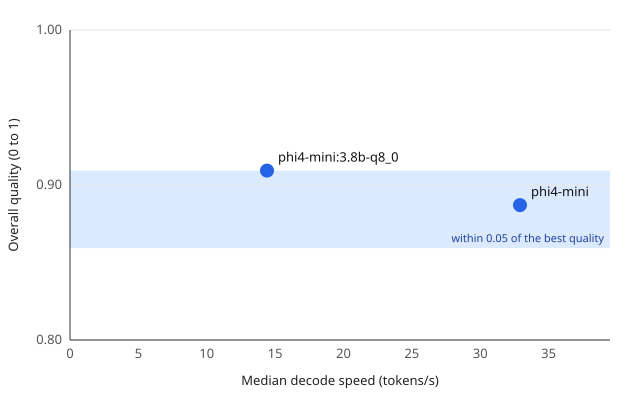

# phi4-mini at Q4_K_M and Q8_0 on a 4 GB laptop GPU

Suite `support_triage_v1` (45 tasks), JSON mode `schema`, one run per task after a warm-up, same machine and settings for every model.

- **Most accurate:** phi4-mini:3.8b-q8_0
- **Fastest:** phi4-mini
- **Best tradeoff:** phi4-mini (the fastest model within 0.05 of the best quality)



## Findings

1. **Q8_0 does not fit in 4 GB.** Ollama keeps 44% of the 4.1 GB Q8_0 build on the GPU,
   against 64% of the 2.5 GB Q4_K_M build, and the model runner's memory grows from 1.9 to
   3.5 GB. Everything else follows from the work moving to the CPU.
2. **It is 2.3 times slower.** Decoding drops from 32.9 to 14.4 tokens/s, the median task from
   1.27 to 2.89 s, the first token from 207 to 400 ms, and a cold start doubles from 4.2 to
   8.3 s. It still meets every latency target for interactive use, with little room left on
   the cold start (8.3 s of 10).
3. **It is slightly more accurate, mostly on priority.** Overall quality 0.909 against 0.887:
   two classification labels in 45 tasks, the size of difference one run cannot tell from
   noise. The priority is right for 11 of 15 tickets against 8, with 4 over-escalations against
   7, while the category is right for 13 against 14. Extraction and summaries score the same
   (0.95 and 0.98).
4. **It costs 1.8 times the GPU energy per task**, 87 J against 47 J, although the GPU draws
   less power (31 W against 39 W): each task takes longer, and the CPU, whose energy is not
   measured, does more of it. Local electricity per million output tokens is INR 5.77 against
   INR 3.25; with the laptop's price over 4 years of 8 hours a day, INR 219 against INR 101.
5. **Q4_K_M stays the pick, and the app keeps it.** A priority gain of three tickets does not
   pay for 2.3 times the latency and 1.8 times the energy on this laptop. On a GPU that holds
   the whole Q8_0 build the slowdown would largely go; the priority gain suggests it is worth
   measuring there.

The verdict and the tables below are written by `local-ai-benchmark report`; the findings are
written by hand from them and from the run log.

## Quality

| Model | JSON mode | Overall | Classify | Extract | Summarize | Valid JSON | Schema-valid |
| --- | --- | --- | --- | --- | --- | --- | --- |
| phi4-mini | schema | 0.89 | 0.73 | 0.95 | 0.98 | 100% | 100% |
| phi4-mini:3.8b-q8_0 | schema | 0.91 | 0.80 | 0.95 | 0.98 | 100% | 100% |

Quality by ticket category (mean over each ticket's three tasks):

| Model | Billing | Refund | Shipping | Technical | Account |
| --- | --- | --- | --- | --- | --- |
| phi4-mini | 0.81 | 0.94 | 0.94 | 0.85 | 0.89 |
| phi4-mini:3.8b-q8_0 | 0.81 | 0.94 | 1.00 | 0.85 | 0.94 |

## Speed and resources

| Model | Decode (tokens/s) | Prefill (tokens/s) | TTFT p50 (ms) | Latency p50 / p90 (ms) | On GPU | Peak GPU memory (MiB) | Mean GPU power (W) | GPU energy per task (J) |
| --- | --- | --- | --- | --- | --- | --- | --- | --- |
| phi4-mini | 32.9 | 687 | 207 | 1,269 / 1,564 | 64% | 2,315 | 39.4 | 47 |
| phi4-mini:3.8b-q8_0 | 14.4 | 320 | 400 | 2,893 / 3,494 | 44% | 2,377 | 31.4 | 87 |

Median latency per task kind (ms):

| Model | Classify | Extract | Summarize |
| --- | --- | --- | --- |
| phi4-mini | 711 | 1,484 | 1,269 |
| phi4-mini:3.8b-q8_0 | 1,544 | 3,324 | 2,893 |

## Latency targets for interactive use

| Model | First token, model loaded (≤ 1,000 ms) | Decode speed (≥ 10 tokens/s) | First token, model not loaded (≤ 10,000 ms) |
| --- | --- | --- | --- |
| phi4-mini | 207: meets | 32.9: meets | 4,169: meets |
| phi4-mini:3.8b-q8_0 | 400: meets | 14.4: meets | 8,261: meets |

Why these limits:

- **First token, model loaded ≤ 1,000 ms:** 1 s is the limit for a user's flow of thought to stay uninterrupted (Nielsen, Response Times: The 3 Important Limits, 1993).
- **Decode speed ≥ 10 tokens/s:** faster than average adult silent reading, 238 words a minute (Brysbaert, Journal of Memory and Language 109, 2019): 5 to 6.5 tokens/s at the 1.3 to 1.6 tokens a word the compared models' summaries use, so text arrives faster than it is read.
- **First token, model not loaded ≤ 10,000 ms:** 10 s is the limit for keeping a user's attention on the task (Nielsen, 1993).

Warm figures are medians over the suite run; the cold first token is the median of the model's latest `benchmark --cold`, each run starting with the model unloaded.

Cold benchmarks: phi4-mini `20261113T131238Z-c2f400`, phi4-mini:3.8b-q8_0 `20261113T131532Z-931bb0` ([cold_starts.json](cold_starts.json)).

## Cost

In INR. Local cost is the electricity the GPU drew plus the laptop's price per hour of use; hosted cost is the same model's API price. Every task of the run counts, the prompt included.

Per million output tokens:

| Model | Local electricity | Local hardware | Local total | Hosted output price | Hosted provider |
| --- | --- | --- | --- | --- | --- |
| phi4-mini | 3.25 | 97.90 | 101.15 | 28.34 | Azure AI Foundry (Phi-4-mini) |
| phi4-mini:3.8b-q8_0 | 5.77 | 213.38 | 219.15 | n/a | n/a |

Per 1,000 tasks:

| Model | Local, electricity only | Local, with hardware | Hosted, input and output |
| --- | --- | --- | --- |
| phi4-mini | 0.10 | 3.10 | 1.84 |
| phi4-mini:3.8b-q8_0 | 0.18 | 6.81 | n/a |

Assumptions:

- **Electricity:** INR 7.70 per kWh. TGSPDCL domestic tariff LT-I(B)(ii), 201 to 300 units a month: the marginal rate of a household in that band. FY 2025-26 retail supply tariff, TGERC order of 29 April 2025, unchanged in its November 2025 order. [Source](https://www.tgerc.telangana.gov.in/file_upload/uploads/Tariff%20Orders/Current%20Year%20Orders/2025/RST%20Order%20FY%202025-26%20FINAL.pdf), read 2026-11-13.
- **Hardware:** INR 108,990 over 4 years of 8 hours a day, INR 9.33 per hour. Retail listing of the ASUS ROG Strix G15 G513QC-HN125T (Ryzen 9 5900HX, RTX 3050 Laptop 4 GB, 16 GB, 1 TB), last changed 21 April 2025; the 2021 launch price could not be confirmed. Counted as if the laptop did nothing else. [Source](https://www.smartprix.com/laptops/asus-rog-strix-g15-g513qc-hn125t-gaming-laptop-ppd1a5hw9yhe), read 2026-11-13.
- **Exchange rate:** INR 94.48 per USD. FBIL reference rate, 4 pm, 5 November 2026. [Source](https://www.fbil.org.in/).
- **phi4-mini hosted:** Azure AI Foundry (Phi-4-mini), USD 0.075 in and 0.3 out per million tokens. Azure Retail Prices API, meters Phi-4-Mini-Input and Phi-4-Mini-Output Tokens, effective 1 February 2025. [Source](https://prices.azure.com/api/retail/prices?$filter=productName%20eq%20%27Azure%20Phi%20Models%27), read 2026-11-13.
- **Limits:** the energy is the GPU board's alone; the CPU, memory and screen draw more. Hardware cost assumes the laptop did nothing else; if it is already owned for other work, the electricity column is the extra cost of running the model.

## Privacy

| Model | Runtime | Network interfaces up | Connections to other machines |
| --- | --- | --- | --- |
| phi4-mini | this machine | VMware Network Adapter VMnet1, VMware Network Adapter VMnet8, Wi-Fi | 0 in 45 runs |
| phi4-mini:3.8b-q8_0 | this machine | VMware Network Adapter VMnet1, VMware Network Adapter VMnet8, Wi-Fi | 0 in 45 runs |

Connections are read from the connection table every sample (0.5 s) for the Ollama server, its model runner and the harness; loopback is this machine, anything else counts.

## Runs

| Model | Run ID | Digest | Quantization | Ollama | Harness commit |
| --- | --- | --- | --- | --- | --- |
| phi4-mini | `20261113T131137Z-4ab4bc` | `78fad5d182a7` | Q4_K_M | 0.40.16 | `99f7b1d` |
| phi4-mini:3.8b-q8_0 | `20261113T131329Z-441065` | `0be8e6979181` | Q8_0 | 0.40.16 | `99f7b1d` |

Exact values: [summaries.json](summaries.json). Environments: [manifests.json](manifests.json).

## Setup

| | |
| --- | --- |
| Machine | Reference laptop: Ryzen 9 5900HX, RTX 3050 Laptop GPU 4 GB, 16 GB RAM, Windows 11, plugged in and idle ([environment](../../docs/environment.md)) |
| Models | `phi4-mini` (Q4_K_M, 2.5 GB, digest `78fad5d182a7`) and `phi4-mini:3.8b-q8_0` (Q8_0, 4.1 GB, digest `0be8e6979181`), Ollama 0.40.16 |
| Suite | `support_triage_v1`, 45 tasks each, JSON schema mode, temperature 0, seed 42, 4096-token context, at most 256 output tokens; one warm-up, each model unloaded first |
| Cold starts | `benchmark --cold`, 5 runs each, at most 64 output tokens; run IDs in the latency section |
| Harness | v1.0.0, commit `99f7b1d`, clean tree, `--require-ac`; both builds measured one after the other on 2026-11-13, 13:11 to 13:16 UTC, so session drift does not enter the comparison |

## Limits

- One run per task: a quality difference of 0.022 is two classification labels.
- GPU energy only; Q8_0 shifts work to the CPU, so the real energy gap is larger than shown.
- The hosted price is for phi4-mini as the provider serves it; no hosted price is listed for a
  Q8_0 build.

## Reproduce

```bash
ollama pull phi4-mini:3.8b-q8_0
for model in phi4-mini phi4-mini:3.8b-q8_0; do
  uv run local-ai-benchmark suite --model "$model" --require-ac
  uv run local-ai-benchmark benchmark --model "$model" --cold --repeats 5 \
    --max-output-tokens 64 --require-ac --prompt "Explain TCP vs UDP in 5 bullet points."
done
uv run local-ai-benchmark report --run-id <Q4 suite run> --run-id <Q8 suite run> \
  --cost configs/cost.yaml --out-dir results/<date>-phi4-mini-q4-vs-q8 \
  --title "phi4-mini at Q4_K_M and Q8_0 on a 4 GB laptop GPU"
```
