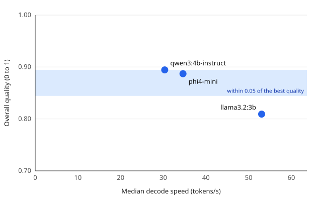

# Three small models on a 4 GB laptop GPU

Suite `support_triage_v1` (45 tasks), JSON mode `schema`, one run per task after a warm-up, same machine and settings for every model.

- **Most accurate:** qwen3:4b-instruct
- **Fastest:** llama3.2:3b
- **Best tradeoff:** phi4-mini (the fastest model within 0.05 of the best quality)



## Findings

1. **qwen3:4b-instruct and phi4-mini are level on quality.** 0.894 against 0.887 overall: a gap
   of 0.007, smaller than one classification label changing (0.011 of the overall score).
   Their strengths differ: qwen3:4b-instruct classifies and extracts slightly better; phi4-mini
   writes the better summaries (0.98 against 0.93).
2. **phi4-mini is the best tradeoff.** At the same quality it decodes 14% faster (34.6 against
   30.3 tokens/s), answers in 13% less time at the median (1.24 s against 1.43 s) and uses 23%
   less GPU energy per task (43 J against 56 J).
3. **llama3.2:3b is the fastest by far and loses only on summaries.** It decodes at 53 tokens/s,
   1.75 times qwen3:4b-instruct; its median task takes 0.75 s and 29 J, half of
   qwen3:4b-instruct; and more of it fits on the GPU (80% against 64 to 66%). On classification
   and extraction it scores as well as the others (0.73 and 0.98); its summaries miss facts
   (0.71). For structured triage without summaries, it is the one to run.
4. **Priority is the hard part, and every model over-escalates.** The category is right for 12
   to 14 of the 15 tickets, the priority for only 8 to 10, although the prompt defines each
   level. 17 of the 18 wrong priorities are one level too high: low read as medium, medium as
   high, high as urgent.
5. **Structured output removes JSON failures.** With the JSON schema sent as Ollama's `format`
   ([ADR-0009](../../docs/decisions/0009-structured-output-for-json-tasks.md)), all 90 JSON
   replies (30 per model) parse and match the schema.
6. **No model fits entirely in 4 GB of VRAM.** At a 4096-token context Ollama keeps 64 to 80% of
   each model on the GPU and runs the rest on the CPU.

The verdict above and the tables below are written by `local-ai-benchmark report`; the
findings are written by hand from them and from the run log.

## Quality

| Model | JSON mode | Overall | Classify | Extract | Summarize | Valid JSON | Schema-valid |
| --- | --- | --- | --- | --- | --- | --- | --- |
| qwen3:4b-instruct | schema | 0.89 | 0.77 | 0.98 | 0.93 | 100% | 100% |
| phi4-mini | schema | 0.89 | 0.73 | 0.95 | 0.98 | 100% | 100% |
| llama3.2:3b | schema | 0.81 | 0.73 | 0.98 | 0.71 | 100% | 100% |

Quality by ticket category (mean over each ticket's three tasks):

| Model | Billing | Refund | Shipping | Technical | Account |
| --- | --- | --- | --- | --- | --- |
| qwen3:4b-instruct | 0.80 | 0.89 | 0.91 | 0.94 | 0.94 |
| phi4-mini | 0.81 | 0.94 | 0.94 | 0.85 | 0.89 |
| llama3.2:3b | 0.72 | 0.89 | 0.83 | 0.78 | 0.82 |

## Speed and resources

| Model | Decode (tokens/s) | Prefill (tokens/s) | TTFT p50 (ms) | Latency p50 / p90 (ms) | On GPU | Peak GPU memory (MiB) | Mean GPU power (W) | GPU energy per task (J) |
| --- | --- | --- | --- | --- | --- | --- | --- | --- |
| qwen3:4b-instruct | 30.3 | 811 | 189 | 1,426 / 1,872 | 66% | 2,339 | 40.1 | 56 |
| phi4-mini | 34.6 | 672 | 202 | 1,235 / 1,525 | 64% | 2,315 | 38.4 | 43 |
| llama3.2:3b | 53.0 | 2,244 | 91 | 751 / 1,139 | 80% | 2,331 | 39.4 | 29 |

Median latency per task kind (ms):

| Model | Classify | Extract | Summarize |
| --- | --- | --- | --- |
| qwen3:4b-instruct | 607 | 1,758 | 1,426 |
| phi4-mini | 690 | 1,481 | 1,235 |
| llama3.2:3b | 321 | 751 | 1,113 |

## Runs

| Model | Run ID | Digest | Quantization | Ollama | Harness commit |
| --- | --- | --- | --- | --- | --- |
| qwen3:4b-instruct | `20261113T060604Z-5bfc28` | `0edcdef34593` | Q4_K_M | 0.40.16 | `9122bf5` |
| phi4-mini | `20261113T060718Z-fb6fbf` | `78fad5d182a7` | Q4_K_M | 0.40.16 | `9122bf5` |
| llama3.2:3b | `20261113T060823Z-920bd3` | `a80c4f17acd5` | Q4_K_M | 0.40.16 | `9122bf5` |

Exact values: [summaries.json](summaries.json). Environments: [manifests.json](manifests.json).

## Setup

| | |
| --- | --- |
| Machine | Reference laptop: Ryzen 9 5900HX, RTX 3050 Laptop GPU 4 GB, 16 GB RAM, Windows 11, plugged in and idle ([environment](../../docs/environment.md)) |
| Runtime | Ollama 0.40.16; every model Q4_K_M, digests in the table above |
| Suite | `support_triage_v1`: 15 fictional support tickets, each classified, extracted and summarized (45 tasks); scorers in the [methodology](../../docs/methodology.md) |
| Settings | Temperature 0, seed 42, 4096-token context, at most 256 output tokens, thinking off, JSON schema mode |
| Procedure | Each model unloaded first, then one unrecorded warm-up and one measured run per task, models one after another on the same day |
| Harness | Commit `9122bf5`, clean tree; the manifest of each run is in [manifests.json](manifests.json) |

## Limits

- One measured run per task and 15 tickets: quality differences below about 0.02 overall are
  within what one or two tasks changing would explain.
- The tickets are fictional and written for this suite; summaries are scored by matching key
  facts, not by a human reader.
- One machine. On a GPU that holds the whole model, every model would run faster and the gaps
  between them could differ.

## Reproduce

```bash
for model in qwen3-4b-instruct phi4-mini llama3.2-3b; do
  uv run local-ai-benchmark suite --model "$model" --require-ac
done
uv run local-ai-benchmark report --out-dir results/<date>-three-model-comparison \
  --title "Three small models on a 4 GB laptop GPU"
```
